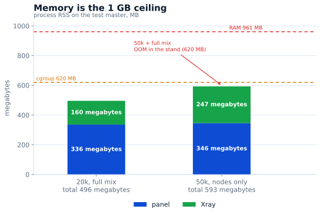

# سعة اللوحة

قياس **2026-11-03** على خادم الاختبار: **1 vCPU، ذاكرة 961 م.ب**، Ubuntu 24،
RosPanel **5.13.0**، Xray-core **26.10.21**. عملت اللوحة داخل netns مستقل بحدود
`MemoryMax=620M` و`MemorySwapMax=0` و`GOMEMLIMIT=300MiB`، بينما بقيت لوحة الإنتاج
تعمل على الخادم نفسه. كان مولّد الحمل على جهاز آخر، لذا لا يدخل CPU الخاص به في قياس اللوحة.

## زمن الاستجابة عند 20 000 مستخدم

مزيج كامل: 11 اشتراكًا/ث، صفحة مستخدمين/ث، بطاقة مستخدم/ث، 0.3 تعديل حد/ث،
0.05 إنشاء/ث، لوحتا معلومات. نافذة دقيقتين بعد التسخين، 0 أخطاء.

| العملية | p50 | p95 | p99 |
|---|---:|---:|---:|
| الاشتراك | 26 ms | 447 ms | 535 ms |
| صفحة المستخدمين | 45 ms | 277 ms | 487 ms |
| بطاقة المستخدم | 28 ms | 277 ms | 488 ms |
| تعديل الحد | 29 ms | 223 ms | 228 ms |
| الإنشاء | 41 ms | 59 ms | 59 ms |

## أين ينتهي 1 GB

عند 20k مع المزيج الكامل: 336 م.ب للوحة و160 م.ب لـXray. وعند 50k في وضع مزامنة
العقد فقط: 346 + 247 م.ب. المزيج الكامل عند 50k لم يتّسع في **بيئة الاختبار**:
قُتلت اللوحة بـOOM بعد نحو 15 ثانية من التسخين. هذا قيد بيئة الاختبار: لوحة الإنتاج
شاركت الخادم، وكانت لوحة الاختبار محدودة بـ620 م.ب. في الإنتاج توجد لوحة واحدة
تحصل على الـ1 GB كاملًا — وهذه الحالة لم تُقس.

| السيناريو | p50 | p95 | الأخطاء | RSS اللوحة |
|---|---:|---:|---:|---:|
| 50k، العقد فقط | 56 ms | 134 ms | 0 | 300–346 م.ب |
| 50k، 14 اشتراكًا/ث | 26 ms | 437 ms | 0 | — |
| 50k، المزيج الكامل | — | — | OOM¹ | — |

¹ في بيئة الاختبار: cgroup بحجم 620 م.ب ولوحة ثانية على الخادم نفسه. في الإنتاج تحصل
اللوحة الواحدة على الـ1 GB كاملًا؛ وهذه الحالة لم تُقس.

## سقف الكتابة في SQLite

القرص نفسه، WAL، `synchronous=FULL`، اتصال واحد، صفوف 256 بايتًا: `fsync` 2 638/ث،
الالتزام التلقائي 1 381 كتابة/ث، معاملة واحدة 63 386 صفًا/ث، و`NORMAL` 20 701 كتابة/ث.
اللوحة تكتب على دفعات، لذا القرص ليس حدّها.

## ماذا يعني ذلك

- **عند 20k لا يمثّل 1 vCPU عنق الزجاجة:** متوسط الحمل 20%، وp95 عند 56%، والقمم
  حتى 88% تأتي من بناء الإعدادات والإنشاءات لا من الاشتراكات.
- **الحد هو الذاكرة:** 1 GB يكفي لنحو 20k بالمزيج الكامل، أو 50k اشتراكًا/مزامنة عقد.
- **50k مع أعمال الإدارة والإنشاءات** لم يتّسع في بيئة 620 م.ب. بحسب المكوّنات يحتاج
  نحو 600–800 م.ب، لذا قد تكفيه لوحة واحدة على 1 GB، لكن ذلك غير مُثبت.
- **النقطة بين 20k و50k لم تُقس:** عندها تنفد الذاكرة لا المعالج.

كيفية التكرار: [tools/bench/README.md](https://github.com/AppsGanin/rospanel/blob/main/tools/bench/README.md).

