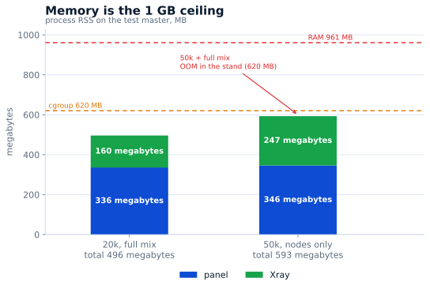

# 面板容量

**2026-11-03** 在测试主机上测得：**1 vCPU、961 MB 内存**、Ubuntu 24、RosPanel
**5.13.0**、Xray-core **26.10.21**。面板运行在独立 netns 中，限制为
`MemoryMax=620M`、`MemorySwapMax=0`、`GOMEMLIMIT=300MiB`；同一台主机上还运行着线上面板。
负载生成器在另一台机器上，因此它的 CPU 不计入面板。

## 20 000 用户时的延迟

完整混合负载：11 次订阅/秒、1 次用户页/秒、1 次用户卡/秒、0.3 次限额修改/秒、
0.05 次创建/秒、2 个仪表盘。预热后统计 2 分钟，0 错误。

| 操作 | p50 | p95 | p99 |
|---|---:|---:|---:|
| 订阅 | 26 ms | 447 ms | 535 ms |
| 用户页 | 45 ms | 277 ms | 487 ms |
| 用户卡 | 28 ms | 277 ms | 488 ms |
| 限额修改 | 29 ms | 223 ms | 228 ms |
| 创建 | 41 ms | 59 ms | 59 ms |

## 1 GB 的边界

20k 完整混合负载占用 336 MB 面板内存和 160 MB Xray。50k 仅节点同步时为
346 + 247 MB。50k 的完整混合负载在**测试环境**中放不下：面板在预热约 15 秒后被 OOM 杀死。
这是测试环境的限制：线上面板共用主机，测试面板被限制在 620 MB。生产环境只有一块面板，
可以使用整个 1 GB —— 这种情况没有测过。

| 场景 | p50 | p95 | 错误 | 面板 RSS |
|---|---:|---:|---:|---:|
| 50k，仅节点 | 56 ms | 134 ms | 0 | 300–346 MB |
| 50k，14 次订阅/秒 | 26 ms | 437 ms | 0 | — |
| 50k，完整混合负载 | — | — | OOM¹ | — |

¹ 测试环境：620 MB cgroup 和同一台 1 GB 主机上的第二块面板。生产环境的单面板可以使用整个
1 GB；这种情况没有测过。

## SQLite 写入上限

同一块磁盘，WAL、`synchronous=FULL`、单连接、256 字节行：`fsync` 2 638/秒、
自动提交 1 381 次写入/秒、单事务 63 386 行/秒、`NORMAL` 20 701 次写入/秒。
面板批量写入，因此磁盘不是限制。

## 结论

- **20k 时 1 vCPU 不是瓶颈：** 平均负载 20%，p95 56%，88% 的尖峰来自配置构建和创建，
  而不是订阅。
- **限制在内存：** 1 GB 可以支撑约 20k 完整混合负载，或 50k 订阅/节点同步。
- **50k 加管理操作和创建** 放不进 620 MB 的测试环境。按组件计算需要约 600–800 MB，
  单面板 1 GB 可能够用，但尚未验证。
- **20k 与 50k 之间的临界点没有测：** 那里耗尽的是内存，不是 CPU。

复现方法：[tools/bench/README.md](https://github.com/AppsGanin/rospanel/blob/main/tools/bench/README.md)。
