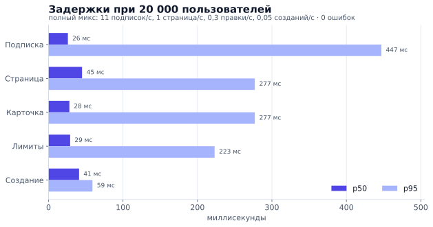
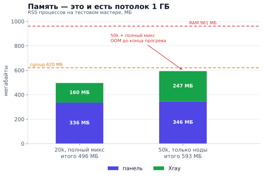
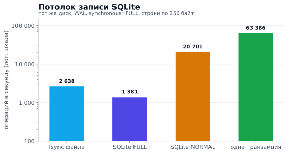

# Ёмкость панели

Замер **2026-11-03** на тестовом мастере: **1 vCPU, 961 МБ RAM**, Ubuntu 24,
RosPanel **5.13.0**, Xray-core **26.10.21**. Панель работала в отдельном netns с
`MemoryMax=620M`, `MemorySwapMax=0`, `GOMEMLIMIT=300MiB`; боевая панель на хосте
жила рядом и занимала свою память. Генератор нагрузки стоял на другой машине, чтобы
не делить CPU с панелью.

## Задержки при 20 000 пользователей

Полный микс: 11 подписок/с, 1 страница пользователей/с, 1 карточка/с, 0,3 правки
лимитов/с, 0,05 созданий/с, 2 дашборда. Окно 2 минуты после прогрева, 0 ошибок.

| Операция | p50 | p95 | p99 |
|---|---:|---:|---:|
| Подписка | 26 мс | 447 мс | 535 мс |
| Страница пользователей | 45 мс | 277 мс | 487 мс |
| Карточка пользователя | 28 мс | 277 мс | 488 мс |
| Правка лимитов | 29 мс | 223 мс | 228 мс |
| Создание пользователя | 41 мс | 59 мс | 59 мс |

## Где кончается 1 ГБ

20k с полным миксом — это 336 МБ панели и 160 МБ Xray. 50k в режиме синхронизации
нод — 346 + 247 МБ. Полный микс на 50k в **стенде** не поместился: панель убита OOM
через ~15 секунд прогрева. Важно, что это стенд: рядом работала вторая, боевая
панель, а тестовая была ограничена cgroup в 620 МБ. В продакшене панель одна и
получает весь гигабайт — этот случай не измерен.

| Сценарий | p50 | p95 | Ошибки | RSS панели |
|---|---:|---:|---:|---:|
| 50k, только ноды | 56 мс | 134 мс | 0 | 300–346 МБ |
| 50k, подписки 14/с | 26 мс | 437 мс | 0 | — |
| 50k, полный микс | — | — | OOM¹ | — |

¹ В стенде: cgroup 620 МБ и вторая панель на том же 1 ГБ. В продакшене одна панель
получает весь гигабайт; этот случай не измерен.

## Потолок записи SQLite

Тот же диск, WAL, `synchronous=FULL`, одно соединение, строки по 256 байт:
`fsync` 2 638/с, autocommit 1 381 запись/с, одна транзакция 63 386 строк/с,
`NORMAL` 20 701 запись/с. Панель пишет пакетами, поэтому запись — не её
ограничитель.

## Что это значит

- **1 vCPU не упирается в CPU на 20k:** средняя загрузка 20%, p95 56%, пики до 88%
  дают сборка конфигов и создания, а не подписки.
- **Упирается в память:** 1 ГБ хватает на ~20k с полным миксом и на 50k
  подписчиков/синхронизацию нод.
- **50k с админкой и созданиями** в стенде не влез в 620 МБ. По компонентам ему
  нужно ~600–800 МБ, так что одной панели на 1 ГБ может хватить, но это не проверено.
- **Точка между 20k и 50k не измерена:** там кончается RAM, а не ядро.

Полный отчёт с условиями: [reports/Бенчмарк ёмкости 2026-11.md](https://github.com/AppsGanin/rospanel/blob/main/reports/%D0%91%D0%B5%D0%BD%D1%87%D0%BC%D0%B0%D1%80%D0%BA%20%D1%91%D0%BC%D0%BA%D0%BE%D1%81%D1%82%D0%B8%202026-11.md).
Как повторить: [tools/bench/README.md](https://github.com/AppsGanin/rospanel/blob/main/tools/bench/README.md).
