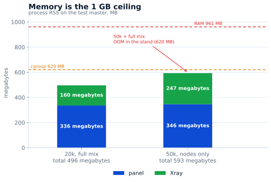

# Panel capacity

Measured on **2026-11-03** on the test master: **1 vCPU, 961 MB RAM**, Ubuntu 24,
RosPanel **5.13.0**, Xray-core **26.10.21**. The panel ran in its own netns with
`MemoryMax=620M`, `MemorySwapMax=0`, `GOMEMLIMIT=300MiB`; the live panel on the host
kept running beside it. The load generator lived on another machine, so its CPU is
not part of the panel's.

## Latency at 20,000 users

Full mix: 11 subscriptions/s, 1 users page/s, 1 card/s, 0.3 limit edits/s, 0.05
creates/s, 2 dashboards. Two-minute window after warmup, 0 errors.

| Operation | p50 | p95 | p99 |
|---|---:|---:|---:|
| Subscription | 26 ms | 447 ms | 535 ms |
| Users page | 45 ms | 277 ms | 487 ms |
| User card | 28 ms | 277 ms | 488 ms |
| Limit edits | 29 ms | 223 ms | 228 ms |
| Creates | 41 ms | 59 ms | 59 ms |

## Where 1 GB ends

20k with the full mix is 336 MB of panel and 160 MB of Xray. 50k in node-sync mode is
346 + 247 MB. The full mix at 50k did not fit the **stand**: the panel was OOM-killed
about 15 seconds into warmup. That is a stand result: the live panel shared the host
and the test panel was capped at 620 MB. A production host runs one panel and gives it
the whole gigabyte — that case was not measured.

| Scenario | p50 | p95 | Errors | Panel RSS |
|---|---:|---:|---:|---:|
| 50k, nodes only | 56 ms | 134 ms | 0 | 300–346 MB |
| 50k, 14 subs/s | 26 ms | 437 ms | 0 | — |
| 50k, full mix | — | — | OOM¹ | — |

¹ In the stand: a 620 MB cgroup and a second panel on the same 1 GB. A production
single panel gets the whole gigabyte; that case is not measured.

## SQLite write ceiling

Same disk, WAL, `synchronous=FULL`, one connection, 256-byte rows: `fsync` 2,638/s,
autocommit 1,381 writes/s, one transaction 63,386 rows/s, `NORMAL` 20,701 writes/s.
The panel batches its writes, so the disk is not its limit.

## What it means

- **1 vCPU is not CPU-bound at 20k:** average load 20%, p95 56%, spikes to 88% come
  from config builds and creates, not subscriptions.
- **Memory is the limit:** 1 GB holds ~20k with the full mix and 50k subscriptions or
  node sync.
- **50k with admin work and creates** did not fit the 620 MB stand. By component it
  needs ~600–800 MB, so one panel on 1 GB may hold it, but that is not proven.
- **The point between 20k and 50k is unmeasured:** it is where RAM runs out, not CPU.

How to repeat: [tools/bench/README.md](https://github.com/AppsGanin/rospanel/blob/main/tools/bench/README.md).
