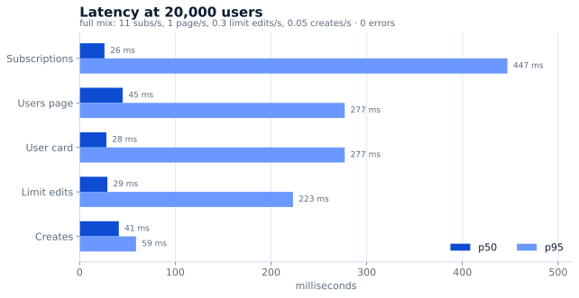
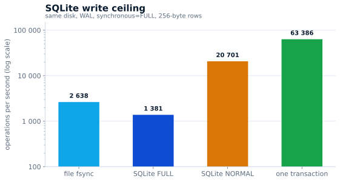

# سعة اللوحة

قياس **2026-11-03** على خادم الاختبار: **1 vCPU، ذاكرة 961 م.ب**، Ubuntu 24،
RosPanel **5.13.0**، Xray-core **26.10.21**. عملت اللوحة داخل netns مستقل بحدود
`MemoryMax=620M` و`MemorySwapMax=0` و`GOMEMLIMIT=300MiB`، بينما بقيت لوحة الإنتاج
تعمل على الخادم نفسه — أي أن الخادم كان أكثر انشغالًا وأضيق ذاكرةً من خادم إنتاجي،
فالأرقام أدناه في الجانب الحذر. كان مولّد الحمل على جهاز آخر، لذا لا يدخل CPU الخاص
به في قياس اللوحة.

## زمن الاستجابة عند 20 000 مستخدم

مزيج كامل على نافذة أربع دقائق بعد التسخين، **0 أخطاء**: 11 اشتراكًا/ث (نحو 2 600 داخل
النافذة)، صفحة مستخدمين/ث وبطاقة مستخدم/ث (240 لكل منهما)، 0.3 تعديل حد/ث (71)،
0.05 إنشاء/ث (11)، لوحتا معلومات.

| العملية | p50 | p95 | p99 |
|---|---:|---:|---:|
| الاشتراك | 26 ms | 447 ms | 535 ms |
| صفحة المستخدمين | 45 ms | 277 ms | 487 ms |
| بطاقة المستخدم | 28 ms | 277 ms | 488 ms |
| تعديل الحد | 29 ms | 223 ms | 228 ms |
| الإنشاء | 41 ms | 59 ms | 59 ms |

## الإنتاجية: الاشتراكات

المستخدمون الـ20 000 أنفسهم تحت حمل اشتراكات فقط — بلا أعمال إدارة ولا مزامنة عقد،
والعميل على جهاز آخر مع keep-alive:

| عملاء متزامنون | اشتراك/ث | p50 | p95 | p99 | الأخطاء |
|---|---:|---:|---:|---:|---:|
| 4 | 577 | 7 ms | 9 ms | 13 ms | 0 |
| 8 | 750 | 11 ms | 14 ms | 19 ms | 0 |
| 16 | 877 | 16 ms | 32 ms | 37 ms | 0 |
| 64 | 887 | 36 ms | 41 ms | 46 ms | 0 |
| 256 | 902 | 210 ms | 531 ms | 1 ث | 0 |

نحو 900 اشتراك في الثانية على vCPU واحد، بينما تشغل اللوحة **17% من نواة واحدة**.
لوحة بـ20 000 مستخدم ترى نحو 11 اشتراكًا/ث عند تحديث كل 30 دقيقة — أي فائض بمقدار
مئتي ضعف: المعالج ليس ما ينفد في خادم بهذا الحجم.

## 50 000 مستخدم

| السيناريو | p50 | p95 | الأخطاء | RSS اللوحة |
|---|---:|---:|---:|---:|
| 50k، 14 اشتراكًا/ث | 26 ms | 437 ms | 0 | — |
| 50k، مزامنة العقد | 56 ms | 134 ms | 0 | 300–346 م.ب |

مسار القراءة لا يتباطأ مع نمو قاعدة المستخدمين: الاشتراك يستجيب في 26 ms عند p50 على
20k و50k معًا، ومزامنة العقد تبقى عند 56 ms p50 / 134 ms p95 بلا أخطاء.

## الذاكرة: كيف تُقدَّر سعة الخادم

عند 20k مع المزيج الكامل: 336 م.ب للوحة و160 م.ب لـXray. وعند 50k في وضع الاشتراكات
أو مزامنة العقد: 346 + 247 م.ب. التقدير بالذاكرة لا بالمعالج: نحو 1 GB لكل 20k
مستخدم مع أعمال الإدارة، أو 50k مستخدم يكتفون بجلب الاشتراكات ومزامنة العقد.

## ماذا يعني ذلك

- **لا يمثّل vCPU واحد عنق الزجاجة:** متوسط الحمل 20% مع المزيج الكامل عند 20k،
  و17% عند 900 اشتراك في الثانية. القمم حتى 88% تأتي من بناء الإعدادات عند الإنشاء
  لا من خدمة المستخدمين.
- **الذاكرة تحدّد حجم الخادم:** 1 GB يحمل نحو 20k بالمزيج الكامل، أو 50k على
  الاشتراكات ومزامنة العقد.
- **القرص ليس حدًّا أيضًا:** اللوحة تكتب على دفعات، والسقف المقيس للقرص الذي عملت
  عليه أعلى بكثير من طلب الحمل (أدناه).

## سقف الكتابة في SQLite

قيس على القرص نفسه وبمعزل عن اللوحة، لمقارنة الكتابة على دفعات به: WAL،
`synchronous=FULL`، اتصال واحد، صفوف 256 بايتًا — `fsync` 2 638/ث، الالتزام التلقائي
1 381 كتابة/ث، معاملة واحدة 63 386 صفًا/ث، و20 701 كتابة/ث مع `synchronous=NORMAL`.

كيفية التكرار: [tools/bench/README.md](https://github.com/AppsGanin/rospanel/blob/main/tools/bench/README.md).

