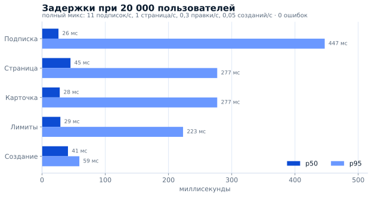
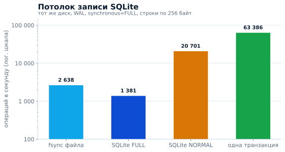

# Ёмкость панели

Замер **2026-11-03** на тестовом мастере: **1 vCPU, 961 МБ RAM**, Ubuntu 24,
RosPanel **5.13.0**, Xray-core **26.10.21**. Панель работала в отдельном netns с
`MemoryMax=620M`, `MemorySwapMax=0`, `GOMEMLIMIT=300MiB`, а боевая панель жила рядом
на том же хосте — машина была загруженнее и теснее по памяти, чем продакшен, так что
числа ниже — с запасом в худшую сторону. Генератор нагрузки стоял на другой машине,
чтобы не делить CPU с панелью.

## Задержки при 20 000 пользователей

Полный микс за четырёхминутное окно после прогрева, **0 ошибок**: 11 подписок/с
(около 2 600 за окно), 1 страница пользователей/с и 1 карточка/с (по 240), 0,3 правки
лимитов/с (71), 0,05 созданий/с (11), 2 дашборда.

| Операция | p50 | p95 | p99 |
|---|---:|---:|---:|
| Подписка | 26 мс | 447 мс | 535 мс |
| Страница пользователей | 45 мс | 277 мс | 487 мс |
| Карточка пользователя | 28 мс | 277 мс | 488 мс |
| Правка лимитов | 29 мс | 223 мс | 228 мс |
| Создание пользователя | 41 мс | 59 мс | 59 мс |

## Пропускная способность: подписки

Те же 20 000 пользователей под чистой нагрузкой на подписки — без админки и синка
нод, клиент с keep-alive на другой машине:

| Клиентов одновременно | Подписок/с | p50 | p95 | p99 | Ошибки |
|---|---:|---:|---:|---:|---:|
| 4 | 577 | 7 мс | 9 мс | 13 мс | 0 |
| 8 | 750 | 11 мс | 14 мс | 19 мс | 0 |
| 16 | 877 | 16 мс | 32 мс | 37 мс | 0 |
| 64 | 887 | 36 мс | 41 мс | 46 мс | 0 |
| 256 | 902 | 210 мс | 531 мс | 1 с | 0 |

Около 900 подписок в секунду на одном vCPU, панель при этом занимает **17% ядра**.
Панель на 20 000 пользователей видит ~11 подписок/с при обновлении раз в 30 минут —
запас два порядка: узким местом у сервера такого размера CPU не становится.

## 50 000 пользователей

| Сценарий | p50 | p95 | Ошибки | RSS панели |
|---|---:|---:|---:|---:|
| 50k, подписки 14/с | 26 мс | 437 мс | 0 | — |
| 50k, синхронизация нод | 56 мс | 134 мс | 0 | 300–346 МБ |

Чтение не замедляется с ростом базы: подписка отвечает за 26 мс по p50 и на 20k, и на
50k, синхронизация нод держится на 56 мс p50 / 134 мс p95 без ошибок.

## Память: как считать размер сервера

20k с полным миксом — это 336 МБ панели и 160 МБ Xray. 50k в режиме подписок или синка
нод — 346 + 247 МБ. Считать надо по RAM, а не по CPU: примерно 1 ГБ на 20k
пользователей с админской работой либо 50k пользователей, которые в основном тянут
подписки и синкают ноды.

## Что это значит

- **Один vCPU не упирается в CPU:** средняя загрузка 20% на полном миксе при 20k и
  17% при 900 подписках/с. Пики до 88% дают сборки конфигов при созданиях, а не
  обслуживание пользователей.
- **Память задаёт размер сервера:** 1 ГБ несёт ~20k с полным миксом либо 50k на
  подписках и синке нод.
- **Диск тоже не ограничитель:** панель пишет пакетами, а измеренный потолок диска, на
  котором она работала, лежит намного выше того, что просит нагрузка (ниже).

## Потолок записи SQLite

Замер на том же диске, отдельно от панели, чтобы пакетную запись было с чем
сравнивать: WAL, `synchronous=FULL`, одно соединение, строки по 256 байт — `fsync`
2 638/с, autocommit 1 381 запись/с, одна транзакция 63 386 строк/с, 20 701 запись/с
на `synchronous=NORMAL`.

Как повторить: [tools/bench/README.md](https://github.com/AppsGanin/rospanel/blob/main/tools/bench/README.md).
